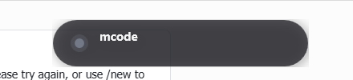
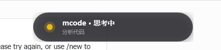
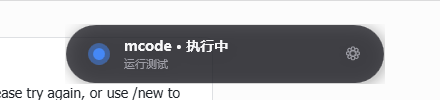
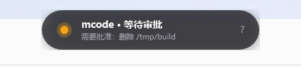
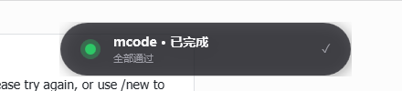
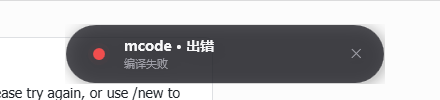

# mcode-island

A Windows desktop **Dynamic Island** for MiniMax Code agents. A small pill anchored to the
top center of your primary display mirrors the agent's working state in real time
(`idle` / `thinking` / `working` / `waiting` / `done` / `error`). You can leave
the terminal in the background and still see exactly what your agent is doing.

## Demo

| idle | thinking | working | waiting | done | error |
|:----:|:--------:|:-------:|:-------:|:----:|:-----:|
|  |  |  |  |  |  |

The pill is a single 320×60 WPF window, always-on-top, click-to-focus: the click goes
back to the desktop app window, to a manually pinned window, or to the
originating terminal. The
widget polls `%APPDATA%\mcode-island\status.json` every 400 ms; the agent (or a
thin wrapper) just writes JSON to that file.

## What problem this solves

While the agent works on a long task (compile, install, test, refactor) the user
often switches away from the terminal to read code, check docs, browse the web.
There is no visible progress signal. The agent may also be paused on a
permission prompt or have failed silently. `mcode-island` makes all of that
visible at a glance, without forcing the user to switch back.

## How the pill is driven

`mcode-island` v0.3.0 supports two modes. The widget behaves the same in
both — what changes is who decides the state.

### Mode A — Hook-driven (mcode 0.2.4+ with `io.minimax.mcode`)

mcode 0.2.4 ships a `io.minimax.mcode` client-extension namespace for
lifecycle Hooks. When the registry accepts it (companion proposal:
[`MiniMax-Code-Plugins` PR #20](https://github.com/MiniMax-AI/MiniMax-Code-Plugins/pull/20)),
the runtime spawns a script from this plugin for every matching event:

| event             | pill state  | script                          | 0.2.4 dispatch |
| ----------------- | ----------- | ------------------------------- | -------------- |
| `SessionStart`    | `idle`      | `session-start.ps1`             | yes            |
| `SessionEnd`      | `idle`      | `session-end.ps1`               | yes            |
| `UserPromptSubmit`| `thinking`  | `user-prompt-submit.ps1`        | yes            |
| `PreToolUse`      | `working`   | `pre-tool-use.ps1`              | yes            |
| `PostToolUse`     | `done`/`error` | `post-tool-use.ps1`          | yes            |
| `Stop`            | `done`      | `stop.ps1`                      | **forward** — see below |
| `PreCompact`      | `thinking`  | `pre-compact.ps1`               | **forward** — see below |
| `Notification`    | `idle`      | `notification.ps1`              | **forward** — see below |
| `SubagentStart`   | `working` (CODEX only) | `subagent-start.ps1` | **forward** — see below |
| `SubagentStop`    | `done` (CODEX only)    | `subagent-stop.ps1`  | **forward** — see below |
| `PermissionRequest`| `waiting`  | `permission-request.ps1`        | **forward** — see below |
| `PermissionDenied`| `error`     | `permission-denied.ps1`         | **forward** — see below |

**Forward events (7 of 12):** the spec reserves these in
`proposals/hooks-detailed-spec.md` and this plugin ships a script for
each, but the mcode 0.2.4 runtime allowlist (`Wso` set in
`@minimax-ai/code@0.2.4`) does not yet dispatch them. The 0.2.4
runtime treats unknown event names as no-op. Once a future mcode
release adds the dispatch, the same `.ps1` files start firing without
any code change here. The smoke test
(`scripts/smoke.mjs`) tags these as `WARN` rather than `FAIL` for that
reason — the **plugin is correct, the runtime is not yet ready**.

If you need any of these events on 0.2.4 today, the supported fallback
is to call `notify-island.ps1` from the agent (Mode B) at the moment
you would otherwise rely on the event firing. The wrapper
`wrap-tool.ps1` covers the `Bash` path automatically.

The agent does not need to remember to push state — the runtime fires the
right script at the right time. `PermissionRequest` is the only
decision-bearing event here; the script returns `{"decision":"ask"}` so the
plugin remains a pure observer (it does not auto-allow or auto-deny).
The runtime's fail-closed default is bypassed only because the script
opts the Hook into the "ask the user" path, so the TUI prompt still
appears and the user can approve or deny. The widget just shows
`waiting` so the user knows to act.

> **Drift lock**: `scripts/smoke.mjs` reads `permission-request.ps1`
> directly and asserts the `decision` field is exactly `ask`. A
> future change that flips the value back to `allow` or `deny` will
> fail the smoke before the PR can be submitted.

Until the registry validator accepts the namespace, the `io.minimax.mcode/`
directory is dormant and the plugin falls through to Mode B.

### Mode B — Agent-pushed (legacy, always works)

The agent (or a thin wrapper) calls `notify-island.ps1` with `-State` and
optional `-Message`. A separate `mcode-status-detect.ps1` polls the runtime's
`ledger.jsonl` / `messages.jsonl` and infers state as a fallback so the
pill still moves even when the agent forgets to push. See
[`SKILL.md`](skills/mcode-island/SKILL.md) for the agent-side call patterns.

#### Which session the detector follows

**The session that wrote its log most recently.** The detector scans every
session log under the runtime's session store and picks the file with the
newest mtime, then infers the state from that file's last complete line.

This is a deliberate decision, not an accident. The conversation the user is
looking at is the one writing to the log, so "whoever wrote last" is the
active conversation. Anything smarter — pinning a session id, asking the
runtime which window is focused — needs a signal the runtime does not expose
to a plugin, and guessing one would make the pill wrong in the common case
to make it right in the rare one.

**Known boundary.** When several conversations run at the same time (a
desktop session plus a CLI session, or two desktop windows), the detector
follows whichever wrote last, so the pill can briefly show a neighbouring
conversation's state. The detector deliberately does not try to disambiguate
this. Two guards keep the damage small:

- the state is re-derived on every change, so the pill corrects itself as
  soon as the followed session writes again;
- a log line that cannot be parsed never falls back to another session's
  message (the reader grows its window until a complete line is found, and
  a read failure reports "no new information" instead of a foreign state).

This is also why the Marketplace build needs the detector: its package ships
no Hook material, so the detector is the only source of state that does not
depend on the agent cooperating.

## Copyable example

### One-line install and run

```cmd
:: 1. install the plugin into your mcode plugins directory
::    (the location printed by `mcode config` for `plugin_dir`)
set PLUGIN_DIR=%USERPROFILE%\.minimax\plugins
if not exist "%PLUGIN_DIR%\mcode-island" mkdir "%PLUGIN_DIR%\mcode-island"
xcopy /E /I "%~dp0" "%PLUGIN_DIR%\mcode-island"

:: 2. start the widget
"%PLUGIN_DIR%\mcode-island\mcode-island.cmd" start
```

### From a MiniMax Code session

Ask the agent to read a large file. The agent's `read` invocation triggers
two state pushes — `working` while the tool runs, `done` when it returns:

```text
> read C:\path\to\very-large-file.cs and summarize the public API

[widget pulses blue: ⚙ working — read: very-large-file.cs]
[widget goes green: ✓ done — read: very-large-file.cs]
```

If the file does not exist:

```text
> read C:\path\to\missing.cs

[widget pulses blue: ⚙ working — read: missing.cs]
[widget goes red: ✕ error — read: missing.cs]
```

### Wrap every bash call (recommended for power users)

The shipped `wrap-tool.ps1` is a **status-only wrapper**: it never executes the
command itself (v0.2.1 removed the prior `Invoke-Expression` path to avoid
shell-injection ambiguity). The agent runs the command via mcode's own bash
tool, then calls `wrap-tool.ps1` to publish the state. Two-step pattern:

```powershell
# 1. Push "working" before the command
& "%PLUGIN_DIR%\mcode-island\wrap-tool.ps1" `
    -Tool bash -Command "npm test" -Description "run tests"

# 2. After mcode's bash tool returns, push the outcome
& "%PLUGIN_DIR%\mcode-island\wrap-tool.ps1" `
    -Tool bash -Command "npm test" -ExitCode $LASTEXITCODE
```

`$LASTEXITCODE` is interpreted as: `0` → `done`, codes in `-WaitingExitCodes`
(default `[1]`) → `waiting`, anything else → `error`. The wrapper returns the
exit code unchanged so the calling shell still sees it.

If you do not need a custom message, `notify-island.ps1` is a leaner direct
alternative:

```powershell
& "%PLUGIN_DIR%\mcode-island\notify-island.ps1" -State working  -Message "bash : npm test"
& "%PLUGIN_DIR%\mcode-island\notify-island.ps1" -State done     -Message "npm test passed"
& "%PLUGIN_DIR%\mcode-island\notify-island.ps1" -State error    -Message "npm test failed"
```

For sub-step progress (Computer Use iterative loops, multi-step plans),
pass `-Step` / `-Total` / `-Detail` so the pill shows what the agent is
doing *right now*:

```powershell
& "%PLUGIN_DIR%\mcode-island\notify-island.ps1" -State working -Message "Computer Use" `
                                              -Step 3 -Total 12 -Detail "fill username field"
# → pill renders: "step 3/12 · fill username field"

& "%PLUGIN_DIR%\mcode-island\notify-island.ps1" -State working -Message "Bash" `
                                              -Step 5 -Detail "npm install"
# → pill renders: "step 5 · npm install"

& "%PLUGIN_DIR%\mcode-island\notify-island.ps1" -State done -Message "Bash ok"
# → pill renders: "Bash ok"  (no step → legacy behavior, backward compat)
```

All three params are optional and backward compatible. The detail field
replaces the message in the rendered pill when present (avoids stacking
"Bash ok · fill username"). See `skills/mcode-island/SKILL.md` for the
full semantics and the contract with the widget renderer.

## Quick start

1. **Install** — copy this folder into your `~/.minimax/plugins/mcode-island/`
   (or any directory you want; the scripts only need to live together).
2. **Start the widget**:
   ```cmd
   mcode-island.cmd start
   ```
   You should see a small dark pill appear at the top center of the screen.
3. **Test a state push** from a new terminal:
   ```powershell
   & "%PLUGIN_DIR%\mcode-island\notify-island.ps1" -State working -Message "demo"
   ```
   The pill should turn blue and pulse for as long as you don't push another state.
4. **Enable logon auto-start** (optional):
   ```powershell
   & "%PLUGIN_DIR%\mcode-island\autostart.ps1" -Action Enable
   ```
   This writes to `HKCU\Software\Microsoft\Windows\CurrentVersion\Run`. No
   admin rights required.
5. **Stop when done**:
   ```cmd
   mcode-island.cmd stop
   ```

## What is in this package

```
mcode-island/
├── plugin.json                       # plugin manifest (official 1.0 schema)
├── README.md                         # this file
├── LICENSE                           # Apache-2.0
├── mcode-island.ps1                  # WPF widget main loop
├── mcode-island.cmd                  # CLI shim: start/stop/status/show/pin/...
├── start-island.ps1                  # launcher (forces STA + hidden console)
├── stop-island.ps1                   # stop the widget
├── status-island.ps1                 # print widget PID + recent log
├── show-island.ps1                   # re-raise hidden widget
├── pin-island.ps1                    # pin the click target to the foreground window
├── autostart.ps1                     # register / unregister Windows logon
├── notify-island.ps1                 # state-push helper (Mode B)
├── wrap-tool.ps1                     # all-in-one bash wrapper
├── mcode-status-detect.ps1           # runtime-state detector (Mode B fallback)
├── io.minimax.mcode/                 # Mode A: client-extension Hooks
│   └── hooks/
│       ├── hooks.json                # 12-event declaration
│       └── scripts/                  # one .ps1 per event
│           ├── _lib.ps1
│           ├── session-start.ps1
│           ├── session-end.ps1
│           ├── user-prompt-submit.ps1
│           ├── pre-tool-use.ps1
│           ├── post-tool-use.ps1
│           ├── stop.ps1
│           ├── pre-compact.ps1
│           ├── notification.ps1
│           ├── subagent-start.ps1
│           ├── subagent-stop.ps1
│           ├── permission-request.ps1
│           └── permission-denied.ps1
├── skills/mcode-island/SKILL.md      # Skill consumed by the agent
└── assets/                           # screenshots embedded above
```

The whole package is a single portable directory. No installer, no native
binary, no symlink, no `node_modules`.

## Requirements

| requirement       | version / note                                        |
| ----------------- | ----------------------------------------------------- |
| Windows           | 10 1809+ or 11 (uses WPF, `user32` `kernel32`)        |
| PowerShell        | 5.1 (ships with Windows 10/11) or PowerShell 7        |
| .NET WPF runtime  | 4.x (ships with Windows 10/11)                        |
| mcode             | any version (Mode B works everywhere); 0.2.4+ activates Mode A |
| execution policy  | `Bypass` for this directory; not changed globally    |
| network access    | **optional** — see "Network access" below. The widget itself is offline. `mcode-status-detect.ps1` only contacts `https://api.minimaxi.com/v1/coding_plan/remains` when a token is configured (see "Accounts" + "Data use"). |
| accounts          | **optional** — see "Accounts" below. No account is required to run the widget; a token is only needed if you want the optional 5-hour usage readout in the pill. |
| paid services     | **none added by this plugin** — the 5h usage endpoint is part of the user's existing MiniMax account, not a separate service |

## Data use

| data             | location                              | lifetime                  | purpose                              |
| ---------------- | ------------------------------------- | ------------------------- | ------------------------------------ |
| `status.json`    | `%APPDATA%\mcode-island\`             | rewritten every transition | widget polling                       |
| `caller.json`    | `%APPDATA%\mcode-island\`             | rewritten every transition | originating terminal HWND (click fallback) |
| `pin.json`       | `%APPDATA%\mcode-island\`             | until `mcode-island unpin` | manually pinned click target        |
| `config.json`    | `%APPDATA%\mcode-island\`             | rewritten on drag         | pill position, size, opacity         |
| `config.json` -> `planApiTokenEnc` | `%APPDATA%\mcode-island\` | until `-Clear` or manual edit | 5h usage API token, DPAPI-encrypted (opt-in; see "Accounts") |
| `widget.pid`     | `%APPDATA%\mcode-island\`             | rewritten on start        | widget process PID                   |
| `island.log`     | `%APPDATA%\mcode-island\`             | append-only, never pruned  | state transition history             |
| `widget.log`     | `%APPDATA%\mcode-island\`             | append-only, never pruned  | widget internal debug                |
| `show.signal`    | `%APPDATA%\mcode-island\`             | transient                 | "raise hidden window" signal        |
| `HKCU\...\Run`   | Windows registry                      | until disabled            | logon auto-start                     |

**Telemetry: none.** **No data is sent off-machine unless a token is
configured (see "Network access" below).** The widget itself is offline
and never reads or writes anything outside `%APPDATA%\mcode-island\`.

## Network access

**The 5h usage readout does not need the network.** The MiniMax Code
runtime already resolves the token plan with the user's own login (the
mcode launcher's "MCode status" panel renders it, footer: "Local view -
credentials hidden"). When the runtime writes that result to a local file,
the plugin reads it and never touches a credential.

```
%APPDATA%\mcode-island\usage.json
```

```json
{
  "fetchedAtMs": 1792800000000,
  "fiveHour": { "remainingPercent": 58, "resetAtMs": 1792800000000, "unlimited": false },
  "weekly":    { "remainingPercent": 40, "resetAtMs": 1792900000000, "unlimited": false },
  "video":     { "remainingCount": 12, "totalCount": 40 }
}
```

`scripts/lib/Plan-Usage.ps1` reads it. `MCODE_PLAN_USAGE_FILE` overrides
the path; `~/.minimax/usage.json` is read as a fallback. `fiveHour` is
required, `weekly` and `video` are optional.

When that file is absent, the plugin falls back to asking the API itself,
and the only network caller in this plugin is `mcode-status-detect.ps1`
(Mode B detector). It only makes a request when ALL of the following are
true:

1. A token is configured — either `set-token.ps1 <token>`, which encrypts
   it into `config.json:planApiTokenEnc`, or an environment variable
   (`MINIMAX_OAUTH_TOKEN` / `MINIMAX_API_KEY`) that the user has
   explicitly opted in to with `set-token.ps1 -AllowEnvToken`. An ambient
   environment variable is not consent to send it to an API, so the
   environment is not read by default.
2. The detector is running (`mcode-island detect-on`, the default).
3. At least 60 seconds have elapsed since the last call (rate-limited).

When all three are true, the detector makes **one** GET to:

- `https://api.minimaxi.com/v1/coding_plan/remains` (HTTPS, no credentials in
  the URL, no fragment, body is a small JSON object)

The response is parsed and only two numbers are written to
`status.json`: `usage5h` (0..100, percent remaining) and `usage5hResetMs`
(milliseconds until the next refresh). Nothing else is persisted and
nothing is sent back to the plugin author. A failure or timeout is
swallowed silently — the pill still works without the readout.

Without a token, the detector skips this call entirely and the pill's
`usage5h` field is `null`.

## Accounts

No account is required to install or use the widget. The token mechanism
exists so users who already have a MiniMax account can opt in to showing
the 5-hour usage readout in the pill.

| token type        | how it enters the plugin                                | where it is stored                                | how it is removed                            |
| ----------------- | -------------------------------------------------------- | -------------------------------------------------- | -------------------------------------------- |
| `MINIMAX_OAUTH_TOKEN` (env) | set by the user in their shell or mcode config | process env (not on disk), read only after `set-token.ps1 -AllowEnvToken` | unset env / close shell / `set-token.ps1 -NoEnvToken` |
| `MINIMAX_API_KEY` (env)     | same as above                                          | process env, same opt-in                          | same as above                                |
| `config.json:planApiTokenEnc` | `set-token.ps1 <token>`                               | `%APPDATA%\mcode-island\config.json`, DPAPI-encrypted (CurrentUser scope) | `set-token.ps1 -Clear` or edit the file      |

The token is **never logged, never written to any other file, and never
sent to a host other than `api.minimaxi.com`**. `set-token.ps1` only writes
to `config.json`; it makes no network call. The detector only reads the
token to attach as an `Authorization: Bearer ...` header on the single
GET documented above.

The token is stored encrypted with Windows DPAPI (CurrentUser scope):
only the same Windows user on the same machine can decrypt it, so
copying `config.json` elsewhere yields nothing usable. A `config.json`
written by an older version, which kept the token in the clear under
`planApiToken`, is migrated in place on the next detector start: the
token is encrypted and the plaintext field is removed. No action is
required from the user.

The request carries the `Authorization` header and nothing else. It does
not claim to be a MiniMax-owned surface.

## CLI reference

```cmd
mcode-island                REM start the widget (no-op if already running)
mcode-island stop           REM stop the widget
mcode-island status         REM show widget PID, session, last 5 log lines
mcode-island show           REM re-raise a hidden widget
mcode-island pin            REM pin the click target to the current foreground window
mcode-island unpin          REM clear the pinned click target
mcode-island autostart-on   REM register for Windows logon
mcode-island autostart-off  REM unregister
```

The `mcode-island` command is the `.cmd` shim. The Skill tells the agent to call
`notify-island.ps1` directly, not the shim, because PowerShell agents can
invoke `.ps1` more easily than `.cmd`.

## How click-to-focus works

The click target is resolved on every click, in this order:

| # | target              | how it is found                        | what the click does              |
| - | ------------------- | -------------------------------------- | -------------------------------- |
| 1 | a manual pin        | `pin.json` (written by `mcode-island pin`) | focuses that window        |
| 2 | the desktop app     | a process named `MiniMax Inside Code` / `MiniMax Code` / `Mavis` in the widget's own session | focuses the app window |
| 3 | the caller's terminal | `caller.json` (written by `notify-island.ps1`) | shows it, or hides it if it is already visible |

**Why the desktop app wins over the terminal.** In the desktop app the agent
is hosted by the app and runs in a terminal the app opened. Hiding that
terminal does not stop the agent — it just leaves the user looking at a static
pill. "Take me back to the app window" is the action that matches the
intent, so the app window is focused and never hidden.

**Why the pin still wins.** `mcode-island pin` stores the foreground window in
`pin.json`, a separate file from `caller.json`: `caller.json` is rewritten on
every status transition, so a pin stored there would not survive the next
push. The pin is the escape hatch for the case where the desktop app is open
next to a CLI session and the user wants the click to go to their terminal.

When the auto-detected HWND is wrong (common on Windows Terminal with
multiple tabs), run `mcode-island pin` from inside the tab you want to return
to. The CLI grabs the foreground window *before* the widget steals focus, so
this is the most reliable fix. `mcode-island unpin` clears it.

The widget is also intentionally hard to kill. Alt+F4 sends `WM_CLOSE`, which
the widget intercepts in `WndProc` and treats as Hide rather than Close. To
re-raise the hidden window: `mcode-island show`. To kill it for real:
`mcode-island stop`.

## Test evidence

This plugin has been exercised on Windows 11 24H2 with PowerShell 5.1, against
a live MiniMax Code session. Empirical evidence (captured during development):

- 59 state transitions recorded in `island.log` over a multi-hour session
  (21 `working` / 14 `done` / 11 `idle` / 6 `waiting` / 5 `thinking` / 1 `error`).
- All 6 states screenshot-verified (`assets/state-*.png`).
- Full state-machine demo (`assets/demo-*.png`): `thinking` → `working` →
  `waiting` → `working` → `done` on a real `bash npm test` run.
- Click-to-focus round-trip verified: from a Feishu tab, click the pill, focus
  jumps to the originating Windows Terminal tab (HWND consistent).
- Click-target order verified against the live desktop app: with
  `MiniMax Inside Code` running, the click resolves to the app window
  (`mode=focus`, never hidden); with a `pin.json` present it resolves to the
  pinned window; with neither, it falls back to the caller's terminal with
  the original show/hide toggle (`mode=toggle`).
- `wrap-tool.ps1` exit-code semantics: 0 → `done`, 1 → `waiting` (default;
  configurable via `-WaitingExitCodes`), other → `error`. As of v0.2.1 the
  wrapper no longer executes the command itself; the agent runs the command
  through mcode's own bash tool and passes the exit code to `wrap-tool.ps1
  -ExitCode`.

## Limitations

- Windows only. The widget uses WPF, `user32`, and `kernel32` P/Invoke.
- One widget per user session.
- `wrap-tool.ps1` only wraps `bash`. Other tools need direct
  `notify-island.ps1` calls. (In Mode A, all tools fire `PreToolUse` /
  `PostToolUse` automatically — no manual push needed.)
- The widget does not show a progress percentage, token usage, or per-tool
  output. v0.2 will.
- File-system polling at 400 ms is not the most efficient design (FileSystemWatcher
  was unstable inside WPF in our tests), but it is robust against any kind of
  writer and never misses an event.
- Mode A (Hook-driven) requires the registry validator to accept the
  `io.minimax.mcode` client-extension namespace. The companion proposal
  ([`MiniMax-Code-Plugins` PR #20](https://github.com/MiniMax-AI/MiniMax-Code-Plugins/pull/20))
  is still pending merge; until then, the `io.minimax.mcode/hooks/` directory
  is dormant and the widget runs in Mode B (agent-pushed + detector).

## Roadmap

v0.2 — Tauri (Rust + WebView) rewrite for richer UI, hover-expand, click-through,
       per-step progress, media-control integration.
v0.3 — Multi-tab awareness, terminal-agnostic focus restore.

## License

Apache-2.0. See [LICENSE](LICENSE).
